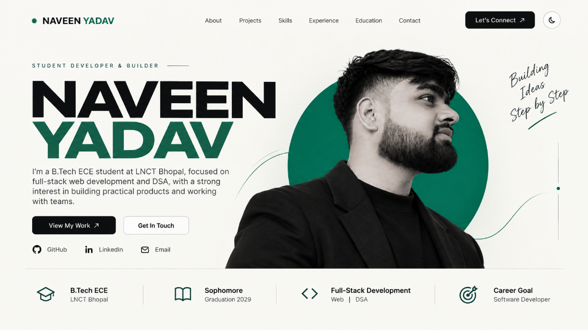

# NAVEEN YADAV — Student Developer & Builder

A personal portfolio website showcasing my journey as a student developer, my technical skills, leadership experience, and selected projects.

## Live Website

[Visit My Portfolio →](https://github.com/naveencodes247)

## Preview

## About

Brief factual description:

- B.Tech ECE student at LNCT Bhopal
- Sophomore
- Graduation: 2029
- Focused on full-stack web development and DSA
- Career goal: Software Developer

## Featured Projects

### MEDORA

Healthcare-focused startup.

Role: CEO

Website:  
https://medoraplus.base44.app/

### AGRO-IOT

Smart India Hackathon 2026 project.

Problem Statement: 26180

Role: Software part

Website:  
https://agro-iotweb.netlify.app/

## Tech Stack

- C++
- DSA
- HTML
- CSS
- JavaScript
- React
- Next.js
- Node.js
- Git / GitHub

## Connect

- GitHub: https://github.com/naveencodes247
- LinkedIn: https://www.linkedin.com/in/nvnydv
- Email: connect.naveen@outlook.in

